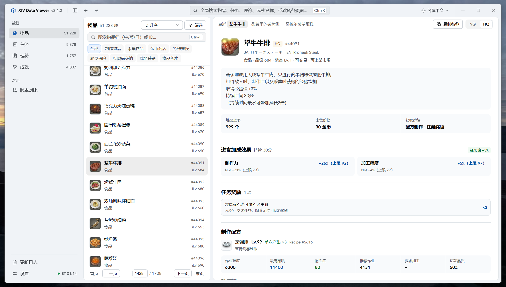

# XIV Data Viewer

**Languages:** **简体中文** | [English](docs/README.en.md) | [日本語](docs/README.ja.md)

基于 [egoist/mygo](https://github.com/egoist/mygo) 构建的本地最终幻想XIV游戏数据解析展示桌面客户端。



---

## 下载使用

请到 [Release](https://github.com/InfSein/xiv-data-viewer/releases) 中下载。

---

## 本地开发与构建

### 1. 环境准备
* [Go](https://go.dev/), 1.27+
* [Node.js](https://nodejs.org/), 22+

### 2. 拉取仓库
```bash
git clone https://github.com/InfSein/xiv-data-viewer
cd xiv-data-viewer
git submodule update --init
```

### 3. 开发构建
|   操作  |         指令        |
| :----: | :-----------------: |
|  本地调试 |  `npm run dev`  |
| 构建客户端 | `npm run build` |
| 自动化测试 |    `npm test`   |

---

## 参考项目

* [ffcafe/elpis](https://github.com/thewakingsands/elpis)
* [xivdev/EXDSchema](https://github.com/xivdev/EXDSchema)
