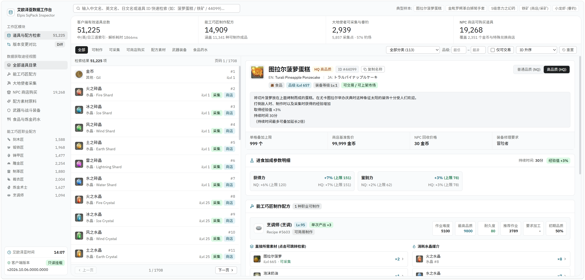

# XIV Data Viewer

基于 [egoist/mygo](https://github.com/egoist/mygo) 构建的本地最终幻想XIV游戏数据解析展示桌面客户端，数据解包参考 [ffcafe/elpis](https://github.com/thewakingsands/elpis)。



---

## 本地开发与构建

### 1. 环境准备
需要 [Go](https://go.dev/)（1.27 或更高版本）及 [Node.js](https://nodejs.org/)（用于快捷 npm 脚本），克隆仓库后请初始化子模块 `git submodule update --init`。

### 2. 本地调试
```bash
npm run dev
```
首次启动按界面引导填写本地国服或国际服客户端路径（至少一项）即可，后续可在「设置」中随时调整。

### 3. 构建 Windows 客户端
```bash
npm run build
```

### 4. 自动化测试
```bash
npm test
```
