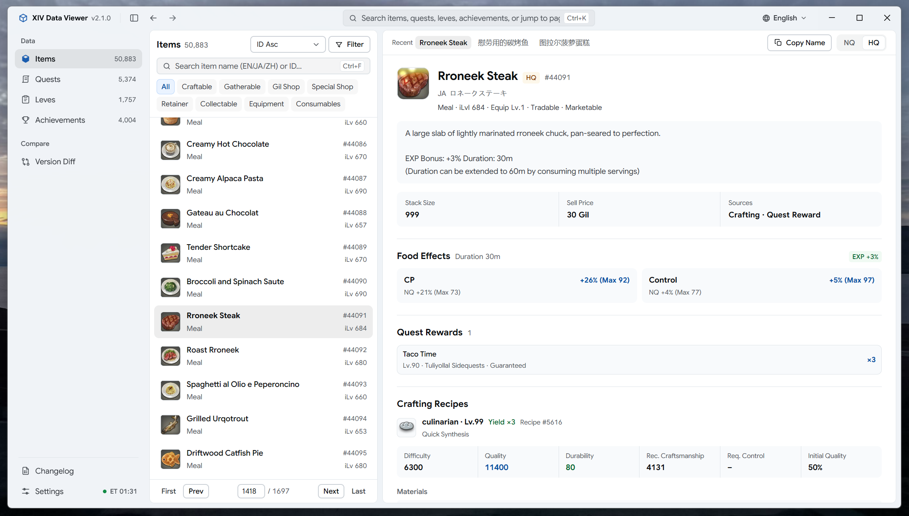

# XIV Data Viewer

**Languages:** [简体中文](../README.md) | **English** | [日本語](README.ja.md)

A local desktop client for parsing and viewing FINAL FANTASY XIV game data, built with [egoist/mygo](https://github.com/egoist/mygo).



---

## Download

Please download the latest version from [Releases](https://github.com/InfSein/xiv-data-viewer/releases).

---

## Local Development & Build

### 1. Prerequisites
* [Go](https://go.dev/), 1.27+
* [Node.js](https://nodejs.org/), 22+

### 2. Clone the Repository
```bash
git clone https://github.com/InfSein/xiv-data-viewer
cd xiv-data-viewer
git submodule update --init
```

### 3. Development & Build
|      Action     |     Command     |
| :-------------: | :-------------: |
| Local debugging |  `npm run dev`  |
|  Build client   | `npm run build` |
| Automated tests |   `npm test`    |

---

## References

* [ffcafe/elpis](https://github.com/thewakingsands/elpis)
* [xivdev/EXDSchema](https://github.com/xivdev/EXDSchema)
