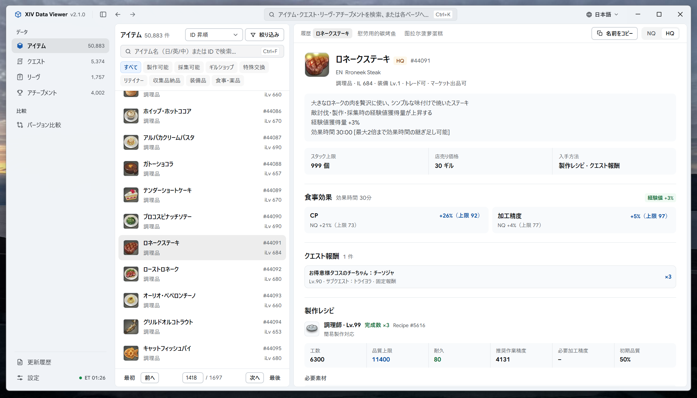

# XIV Data Viewer

**Languages:** [简体中文](../README.md) | [English](README.en.md) | **日本語**

[egoist/mygo](https://github.com/egoist/mygo) をベースに構築された、ファイナルファンタジーXIV のゲームデータをローカルで解析・表示するデスクトップクライアントです。



---

## ダウンロード

[Release](https://github.com/InfSein/xiv-data-viewer/releases) からダウンロードしてください。

---

## ローカル開発・ビルド

### 1. 事前準備
* [Go](https://go.dev/), 1.27+
* [Node.js](https://nodejs.org/), 22+

### 2. リポジトリのクローン
```bash
git clone https://github.com/InfSein/xiv-data-viewer
cd xiv-data-viewer
git submodule update --init
```

### 3. 開発・ビルド
|         操作         |    コマンド     |
| :------------------: | :-------------: |
|   ローカルデバッグ   |  `npm run dev`  |
| クライアントのビルド | `npm run build` |
|      自動テスト      |   `npm test`    |

---

## 参考プロジェクト

* [ffcafe/elpis](https://github.com/thewakingsands/elpis)
* [xivdev/EXDSchema](https://github.com/xivdev/EXDSchema)
